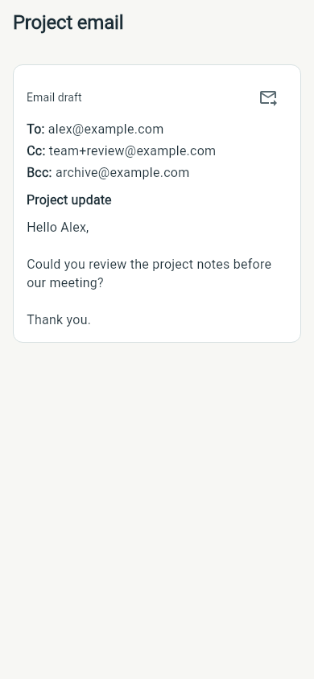

# Wing plugin for Hermes

Add extra features to the [Wing Android app](https://github.com/tarkilhk/Wing)
through your Hermes backend.

## Features

- **GPT Live voice:** talk using your ChatGPT subscription or OpenAI API, with
  context from the selected Hermes profile. Hermes handles credentials and tools;
  Wing handles audio on your phone.
- **Email draft cards:** ask Hermes to draft an email, then open the card in your
  chosen email app with recipients, subject and body filled in. Edit and send
  there. Email drafts need no OpenAI account or mail account access.



## Install

Use current upstream Hermes (at least 0.23.0) with its dashboard/gateway available
to Wing, plus a matching Wing app build.

```sh
hermes plugins install https://github.com/tarkilhk/wing-hermes-plugin
hermes plugins enable wing
```

Install and enable the plugin in each Hermes profile where you want these
features. For a named profile, use the profile selector, for example:

```sh
hermes --profile work plugins install https://github.com/tarkilhk/wing-hermes-plugin
hermes --profile work plugins enable wing
```

Restart the serving Hermes process if its plugin-loading workflow requires it.

For voice, select **ChatGPT subscription** or **OpenAI API** in Wing. Subscription
mode needs an OpenAI Codex sign-in with voice access in that Hermes profile; API
mode needs the profile's OpenAI voice credentials and has separate billing.
In **App settings → Voice → GPT-Live voice**, choose the voice for the next call.
Wing keeps separate subscription/API choices; the plugin passes the selection
without changing the Hermes profile configuration. API choices use Hermes’s
`GPT_LIVE_VOICES` catalog. Subscription supports the nine standard ChatGPT voices.
Spoken exchanges are not yet saved as complete Hermes conversation turns.

For email cards, enable the `wing_email` toolset and ask Hermes to draft an email.
Hermes must use the draft tool and include its card reference. Drafts stay in the
selected profile, and older cards retain their original text after revisions.
The plugin never sends email.

## Credits

GPT Live voice builds on [Synero's hermes-live-voice](https://github.com/Synero/hermes-live-voice).
Email draft cards adapt the structured draft/version design from
[arsiktech/hermes-draft-cards](https://github.com/arsiktech/hermes-draft-cards).
Both projects are MIT-licensed; their attribution is preserved in
[NOTICE](NOTICE.md) and [LICENSE](LICENSE).

See the [plugin reference](docs/PLUGIN_REFERENCE.md) for data handling, API details
and limitations, or [development and publication](docs/DEVELOPMENT.md) for tests,
release automation and catalog submission.
